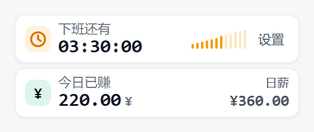
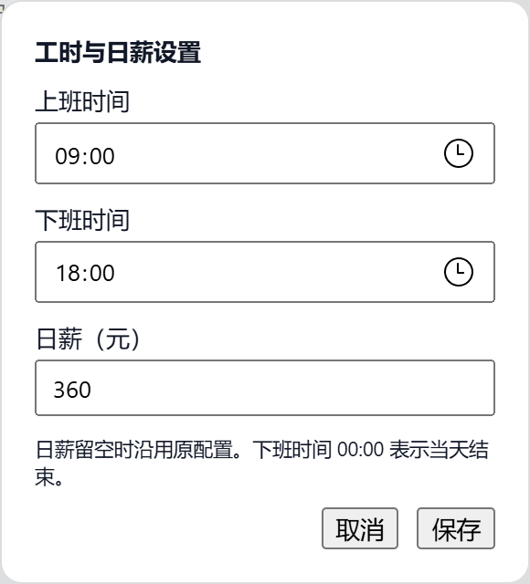

# dsh-plugin-offwork

下班倒计时 + 今日已赚，两张挂在**侧边栏底部**的统计卡片，for [DeepSeek Harness](https://github.com/deepseek-ai/dsh)。

## 预览



示例班次为 09:00–18:00，日薪 360 元。截图取自 14:30，此时已工作 5 小时 30 分。

## 它做什么

| 卡片 | 显示 | 细节 |
|---|---|---|
| 下班还有 | `01:10:25` 式倒计时，每秒刷新 | 右侧 12 根柱子表示今天的工作进度。超过设定的下班时间后显示加班时长，非工作日显示「今天不上班」 |
| 今日已赚 | `409.09 ¥`，2 位小数 | 日薪 × 已上班时长 ÷ 工作日总时长，到下班点拿满。右侧标出当前日薪 |

两张紧凑卡片位于侧边栏底部，侧边栏收起时随底栏一起隐藏。

## 安装

从[此 fork 的 GitHub Releases](https://github.com/DescartHsu/dsh-plugin-offwork/releases/latest) 下载插件安装包 `.tgz`。使用 DSH CLI 的用户可在下载目录运行：

```bash
dsh plugin --profile desktop add ./dsh-plugin-offwork-0.3.0.tgz
```

装完**完全退出并重启 DSH Desktop**，卡片出现在侧边栏底部。

## 配置

点击倒计时卡右侧的 **设置**，填写上班时间、下班时间和日薪，点 **保存** 即时生效。工时按同一天计算，下班时间选 `00:00` 代表当天午夜。日薪可以填 `0`，也可以留空以沿用原配置（默认按月薪 ÷ 月工作日折算）。



设置保存在 **`~/.dsh/offwork.json`**。也可以手动编辑此文件，卡片会在 60 秒内刷新。示例：

```json
{
  "workStart": "09:00",
  "workEnd": "17:00",
  "dailySalary": 350,
  "workdays": [1, 2, 3, 4, 5]
}
```

文件中使用 24 小时制，午夜下班写作 `"24:00"`。`workdays` 中 1 表示周一，7 表示周日。弹窗保存时保留已有的工作日及月薪等字段。配置文件优先于 [`cordis.patch.yml`](cordis.patch.yml)，同一层中明确填写的日薪优先于月薪折算值。

**不要直接改 node_modules 里的副本**——会被下一次 apply 覆盖，改动请走 `~/.dsh/offwork.json` 或仓库文件。

## 它怎么工作

- **宿主半侧** [`lib/index.js`](lib/index.js) 合并三层设置（默认 → patch config → `~/.dsh/offwork.json`），通过 `GET /api/offwork/config` 读取，通过同一路由的 `PUT` 保存。
- **浏览器半侧** [`lib/client.js`](lib/client.js)：手写 bundle（无构建步骤），往 `sidebar.footer.action` 槽注册卡片，每 60 秒重取配置、每秒重算倒计时／加班时长与收入。

## License

MIT
